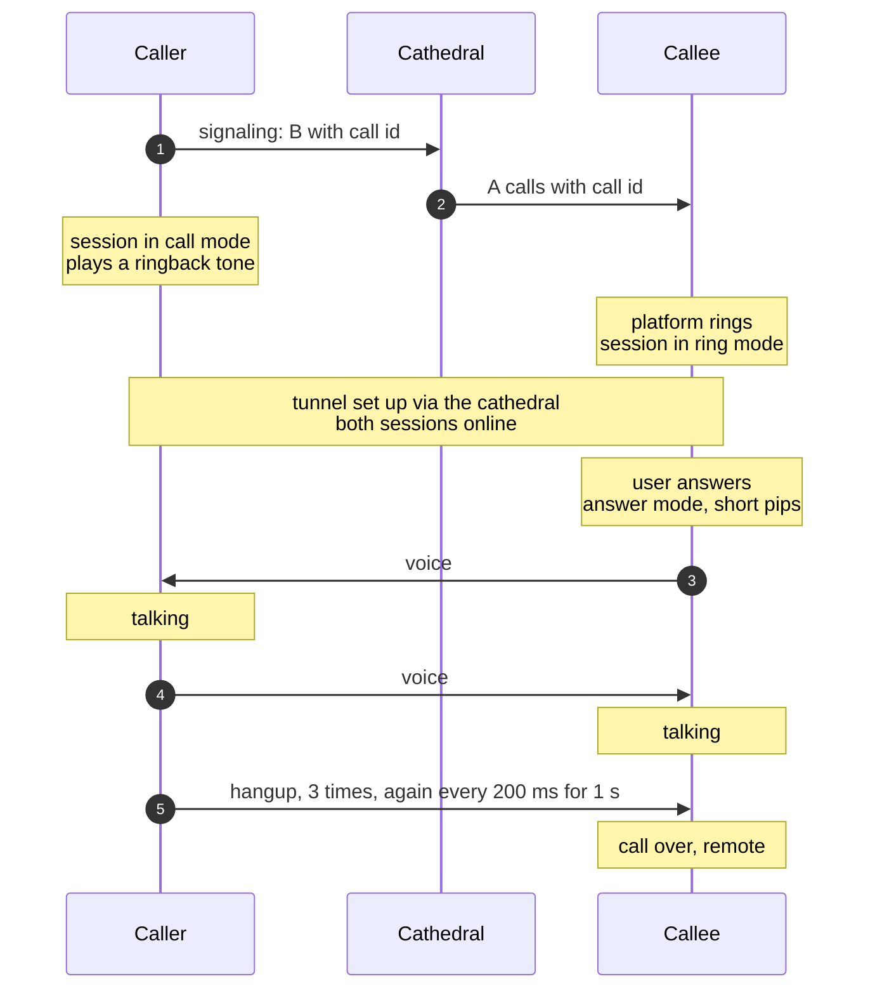
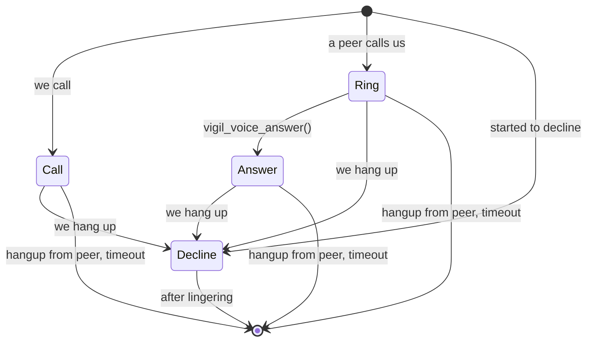
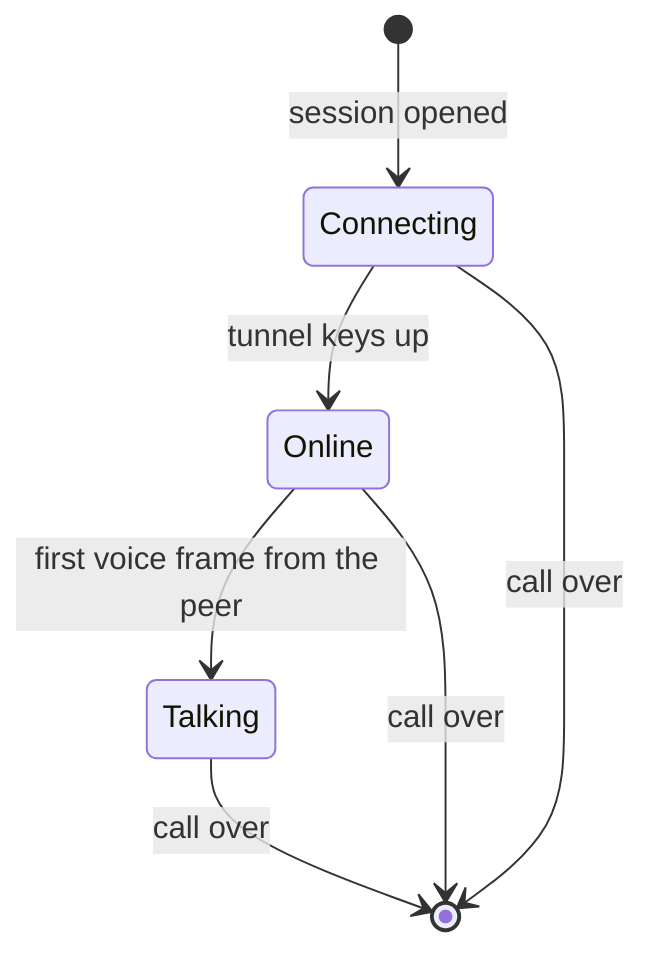
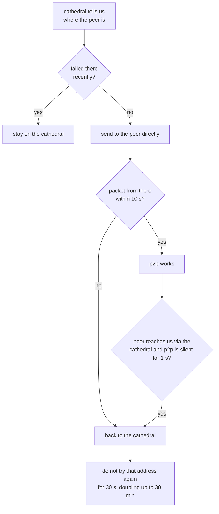

# Calls

A call has two parts. Signaling tells a peer that we are calling.
Once the peer rings, both sides run a voice session: a tunnel of its own
between the two phones that carries the voice, and the video when a camera
is on (see [video.md](video.md)).

| Term       | What                                                           |
|------------|----------------------------------------------------------------|
| signaling  | the liturgy on the cathedral that tells a peer we are calling  |
| discovery  | the liturgy that tells us which peers are around to be called  |
| call id    | a number that tells one call from the next, never 0            |
| session    | the tunnel and codec state of one call on one phone            |
| mode       | what a session does: call, ring, answer or decline             |
| frame      | 20 ms of voice, or a hangup, always 160 bytes on the tunnel    |

## Overview



The caller only sends voice once the callee did, so both sides go live
together and neither hears the other before the callee answered.

## Signaling

Calls use two liturgies on the cathedral, each with its own socket. Both
run in the flock of the gospel cathedral with domain `0x0a`.

```
liturgy     group                what we send          what we get
──────────  ───────────────────  ────────────────────  ─────────────────────────
signaling   liturgy_group        the call id for the   each peer that calls us,
                                 peer we call          with its call id
discovery   liturgy_group + 1    only that we are      which peers are around
                                 around
```

`vigil_call_dial(peer)` stops signaling any other peer and signals this
one with a new call id. We call one peer at a time. `vigil_call_hangup()`
stops all signaling.

We update both liturgies every 3 s. When the peer we call changes, the
update goes out right away, but no sooner than 1.5 s after the last one.

A peer that calls us is reported until the cathedral has not pushed that peer
to us for 9 s. When a call ends, `vigil_call_done(peer)` remembers the
call id of that peer, so the same call does not ring again while the
cathedral still shows that call. A new call id from the peer rings again.

The signaling liturgy keeps the remembrances of the cathedral, the list of
other cathedrals to fall back on. A liturgy that hears nothing from its
cathedral for 45 s (20 s for a new signaling cathedral, 10 s for a new
discovery cathedral) moves to another one, picked at random from the
remembrances and the configured cathedral. When the discovery liturgy
times out, no peer is reported as around until the liturgy hears from a
cathedral again.

### Call state for the platform

The core status carries a `call` object:

```
{"alive":bool, "liturgies":[...], "cathedral":"ip:port",
 "peers":["05", ...],                     peers around to be called
 "dialing":"05", "reachable":bool,        the peer we call, null if none,
                                          reachable if that peer signals
                                          us as well
 "incoming":["09", ...]}                  peers calling us, minus calls
                                          that ended and the peer we call
```

The platform rings for a peer in `incoming` and starts a session in ring
mode for that peer. The platform stops ringing when the peer leaves
`incoming`.

## Sessions



```
mode      audio   sends voice              plays
────────  ──────  ───────────────────────  ─────────────────────────────────
call      on      once the peer talks      ringback until talking
ring      off     never                    nothing, the platform rings
answer    on      once the tunnel is up    pips until talking
decline   as was  never                    -
```

A hangup from the peer ends a session in any mode. Hanging up while in
call or answer mode sends 3 hangup frames right away and moves to decline
mode, so the hangup gets through even if some frames are lost.

### Session states



Only call and answer mode reach talking, ring mode ignores voice.

### Declining

A session in decline mode sends 3 hangup frames every 200 ms while the
tunnel is up. The session ends 1 s after the tunnel came up or after we
declined, whichever was later. If the tunnel never comes up, the session
ends 5 s after we declined.

### Timeouts

```
not talking 60 s after the start               timeout, did not answer
ring mode (or answered from it), tunnel not    timeout, never showed up
up 10 s after the start
talking, nothing heard for 20 s                 timeout, went quiet
tunnel not up, neither side signals the other,  remote, gave up
5 s after the start (vigil_voice_call() only)
```

A session ends as `local`, `remote`, `timeout` or `error`.

## Running a session

There are two ways to run a session, both run the same session code.

```
vigil_voice_call(peer, mode)          run by the core event loop (Android)
                                      hangs up any session the core runs first
                                      uses the cathedral of the signaling
                                      liturgy
vigil_voice_hangup()                  hangs that session up
vigil_voice_answer()                  answers a session in ring mode

vigil_voice_run(id, cfg, peer, mode,  blocks on its own thread until the
                cathedral)            call is over, returns why (iOS app)
vigil_voice_run_id()                  a new id, higher than all before it
vigil_voice_stop(id)                  stops the session with this id and
                                      every one before it
```

Only one session runs at a time, a second one ends right away with
`error`. `vigil_voice_run()` takes the cathedral as `ip:port`, or uses the
one in the configuration and tries to resolve that one for up to 15 s.

When a session run by the core ends, the core calls `vigil_call_done()`
for its peer.

## The tunnel

The session runs its own tunnel with the peer through the cathedral,
in the same flock domain `0x0a` as signaling. The tunnel id is our peer
id followed by the peer id we call, so both sides use their own. The mtu
is that of the configuration, at most 1100.

When the cathedral tells us where the peer is and the configuration
allows p2p, the session sends to the peer directly. A peer behind the
same public address as us, or on loopback, is always reached via the
cathedral.




A packet from the direct address of the peer while we still relay moves
us to that address too, the peer already sends from there. Erased tunnel
keys or a changed network send the session back to the cathedral, a
changed network also gives the session a new socket.

## Voice

```
voice frame, 160 bytes
+------+-----+-----+--------+-----------------------------+
| type | rfu | seq | length | opus data, zero padded      |
+------+-----+-----+--------+-----------------------------+
  1      1     2     2        up to 154

type    1 voice, 2 hangup, 4 video report, 5 video NACK
seq     voice only, counts up from 1 and skips 0
length  bytes of opus data
```

Every multi-byte field is big endian. Video fragments are the only
packets on the tunnel larger than 160 bytes.

The audio is 48 kHz mono, 960 samples or 20 ms per frame. Opus runs in
voip mode with its own forward error correction, expecting 5% loss. A
muted call keeps sending frames, of silence.

When frames go missing the receiver fills in up to two missing frames:

```
seq jumps by 2     the missing frame is rebuilt from the opus FEC data
                   in the frame that arrived
seq jumps by 3+    one more frame is guessed by opus loss concealment
seq goes back      the frame is too late and dropped
```

The platform audio and the session exchange frames through two rings of
16 frames. Playback starts once 3 frames are queued, and waits for 3 again
after the ring ran empty. Captured audio is dropped when its ring is full.

The ringback is a 425 Hz tone, on for 1 s every 5 s. The pips are 425 Hz,
on for 150 ms every second.

## Status

`vigil_voice_status()`:

```
no session  {"running":false, "calls":n, "end":"local", "rx_bytes":n,
             "tx_bytes":n}

session     {"running":true, "calls":n, "peer":"05",
             "state":"connecting" | "online" | "talking",
             "muted":bool, "uptime":seconds talking, "rx":frames,
             "tx":frames, "p2p":bool, "path":"ip:port",
             "cathedral":"ip:port", "rx_bytes":n, "tx_bytes":n,
             "video":{...}}
```

`calls` counts the sessions that ended, `end` says why the last one did.

## Limits

| Define                       | Value         | Scope                                   |
|------------------------------|---------------|-----------------------------------------|
| VIGIL_CALL_NOTIFY            | 3 s           | between liturgy updates                 |
| VIGIL_CALL_NOTIFY_MIN        | 1.5 s         | least time between updates on a change  |
| VIGIL_CALL_PRESENT_EXPIRE    | 9 s           | a caller the cathedral stopped pushing  |
| VIGIL_CALL_TIMEOUT_INIT      | 20 s          | first wait on a signaling cathedral     |
| VIGIL_CATHEDRAL_TIMEOUT_INIT | 10 s          | first wait on a discovery cathedral     |
| VIGIL_CATHEDRAL_TIMEOUT      | 45 s          | silence before moving cathedral         |
| VOICE_CONNECT_TIMEOUT        | 60 s          | to get to talking                       |
| VOICE_RING_VERIFY            | 10 s          | for a caller to show up on the tunnel   |
| VOICE_RX_TIMEOUT             | 20 s          | silence while talking                   |
| VOICE_SIGNAL_GRACE           | 5 s           | before a session gives up on signaling  |
| VOICE_DECLINE_LINGER         | 1 s           | hangups sent after declining            |
| VOICE_DECLINE_INTERVAL       | 200 ms        | between rounds of hangups               |
| VOICE_DECLINE_WAIT           | 5 s           | for a declined peer to show up          |
| VOICE_HANGUP_COUNT           | 3             | hangup frames per round                 |
| VOICE_RESOLVE_TIMEOUT        | 15 s          | resolving the cathedral                 |
| VOICE_P2P_VERIFY             | 10 s          | for a p2p path to show it works         |
| VOICE_P2P_SILENT             | 1 s           | p2p silence before going back           |
| VOICE_P2P_RETRY / MAX        | 30 s / 30 min | before trying a failed path again       |
| VOICE_MTU_MAX                | 1100          | largest mtu of a call                   |
| VIGIL_VOICE_PAYLOAD          | 160 B         | every packet that is not video          |
| VOICE_RING_FRAMES            | 16            | audio frames per ring                   |
| VOICE_PLAYBACK_PRIME         | 3             | frames queued before playing            |
