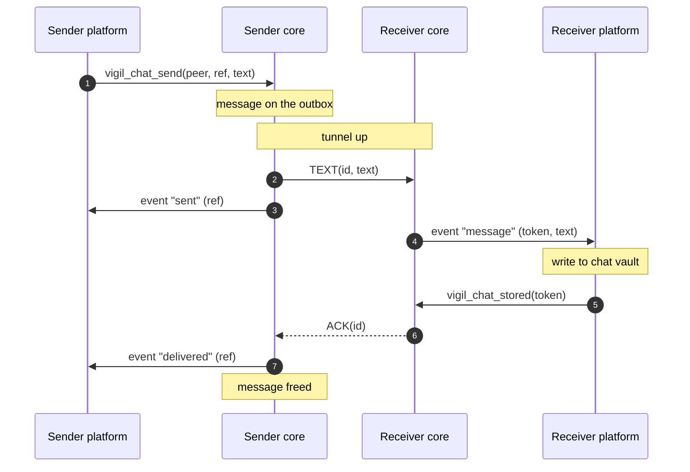
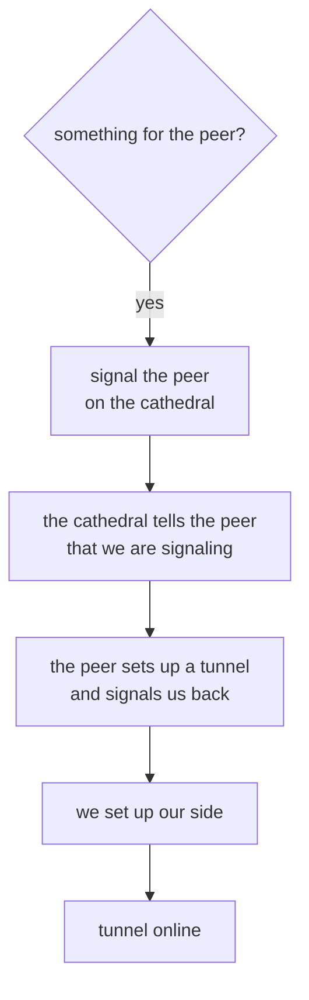
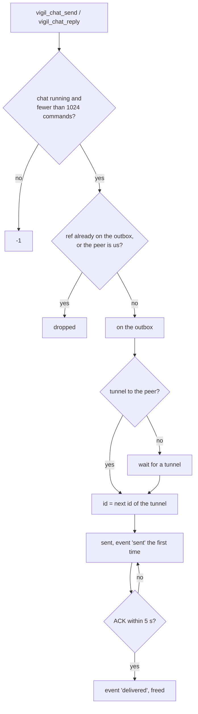
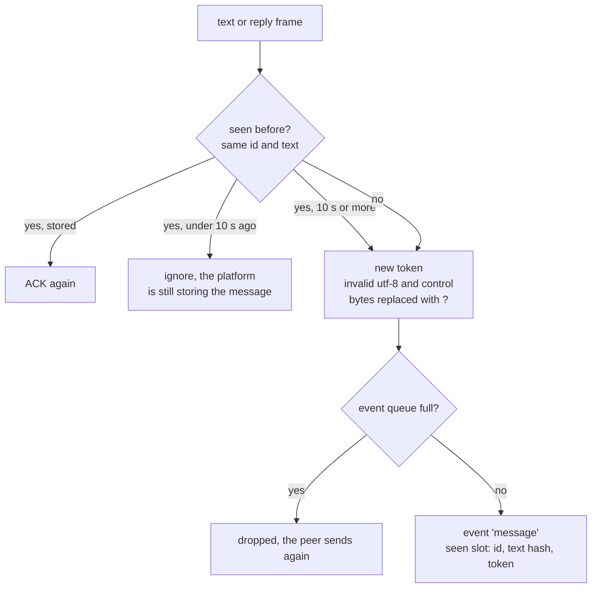
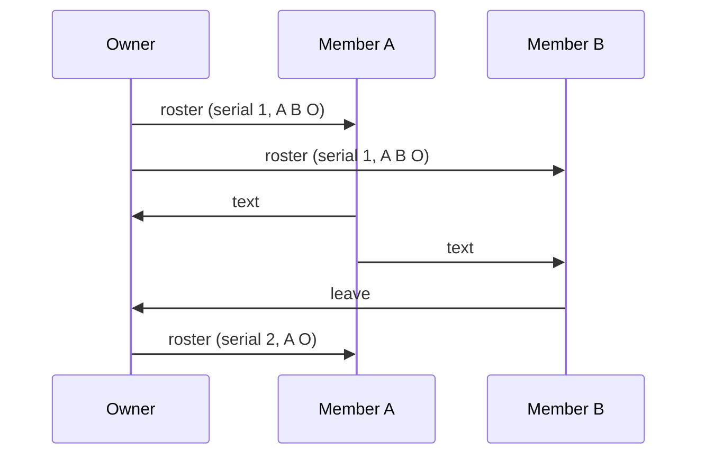

# Chats

Text messages travel as frames over a tunnel of their own between two
phones. A group chat uses the same tunnels, a message in a group is sent
to every member on its own. Images, files, voice messages and avatars use
the same tunnels, see [parcel.md](parcel.md).

| Term      | What                                                            |
|-----------|-----------------------------------------------------------------|
| frame     | one message, ack or heartbeat, always 523 bytes on the tunnel   |
| ref       | the number the platform gives a message it sends, ours to keep  |
| id        | the number a message gets on a tunnel, counting up from 1       |
| token     | the number a received message gets, for `vigil_chat_stored()`   |
| outbox    | the messages for a peer that were not acked yet                 |
| seen slot | a message we received, so we can tell a resend from a new one   |
| owner     | the peer that set up a group, only the owner changes its roster  |
| roster    | the name and members of a group, as its owner sends it           |
| tally     | how many members acked a group message and how many we wait for |

## Overview



A message stays on the outbox until our peer acks the message or the
platform calls `vigil_chat_forget(peer)`. Messages do not expire, a
message for a peer that is away goes out once there is a tunnel to that
peer again.

## Wire formats

Every multi-byte field is big endian.

```
frame, 523 bytes
+----------+-----+------+----------------------------------------+
| id       | len | type | data[512]                              |
+----------+-----+------+----------------------------------------+
  8          2     1      len bytes used, the rest zero

type  1 text, 2 ack, 3 heartbeat, 4 data ack, 5 reply, 6 topic,
      7 topic text, 8 group
id    the message id, the id of the message acked for an ack,
      ffffffffffffffff for a heartbeat
```

A text frame carries up to 512 bytes of text. An ack carries no data. Data
acks are in [parcel.md](parcel.md). A frame with id 0 is dropped.

```
reply data
+--------+------+---------------------------------------+
| author | hash | text                                  |
+--------+------+---------------------------------------+
  1        8      up to 503

author  the peer id of who wrote the message replied to
hash    the hash the platform gave for the message replied to, not 0
```

```
topic data
+-------+-------+------------+
| id    | color | name       |
+-------+-------+------------+
  8       4       up to 32

id      the random id of the topic, not 0
color   0xRRGGBB
name    the name of the topic, empty when the topic was removed
```

```
topic text data
+-------+--------+------+-------------------------------+
| topic | author | hash | text                          |
+-------+--------+------+-------------------------------+
  8       1        8      up to 495

topic   the id of the topic the text is in, not 0
author  as in a reply
hash    as in a reply, 0 if the text replies to nothing
```

```
group data
+-------+----+--------+------+--------------------------------------+
| owner | id | serial | type | data                                 |
+-------+----+--------+------+--------------------------------------+
  1       8    4        1      up to 498

owner   the peer id of the owner of the group
id      the random id the owner gave the group, not 0
serial  the serial of the roster the sender knows, for a roster the
        serial of that roster, it goes up with every change the owner
        makes
type    1 text, 5 reply, 6 topic, 7 topic text, 9 roster, 10 leave
data    as in a frame of that type, the roster, or empty for a leave
```

```
roster data
+-------+-------------+------------+
| state | members[32] | name       |
+-------+-------------+------------+
  1       32            up to 32

state    0 open, 1 ended
members  bit n set = peer n is a member, the owner too
name     the name of the group, may be empty
```

```
heartbeat data
+-----+----------+--------+----------+--------------+---------------+-------------+--------------+--------------+--------------+
| uid | nick[16] | typing | features | instance[64] | signature[64] | avatar_have | typing_owner | typing_group | typing_topic |
+-----+----------+--------+----------+--------------+---------------+-------------+--------------+--------------+--------------+
  8     16         1        1          64             64              8             1              8              8

uid           random for each tunnel, a new one means the peer started over
nick          our nickname, empty if we have none
typing        1 while we type in this chat
features      0x01 DATA, 0x02 REPLY, 0x04 NAME, 0x08 AVATAR, 0x10 TOPIC,
              0x20 GROUP
instance      our name, signed by our flock, zero without NAME
signature     the signature of our flock over our instance, zero without NAME
avatar_have   the hash of the avatar of this peer that we hold, 0 if none
typing_owner  the owner of the group we type in
typing_group  the id of the group we type in, 0 if none
typing_topic  the topic we type in, of this chat or of the group, 0 if
              none
```

We send `DATA`, `REPLY`, `TOPIC` and `GROUP` always, `NAME` when our flock
signed our name and `AVATAR` while we have an avatar.

## Tunnels



We signal a peer on the chat signaling liturgy, group `0000`, while:

- we hold messages for that peer,
- its chat is open on our side (`vigil_chat_open(peer, 1)`),
- a message of ours was delivered to that peer, or we got one from that
  peer, in the last 60 s,
- that peer signals us and our tunnel with that peer is not online yet.

The cathedral pushes us every peer that signals us. A peer counts as
around until the cathedral has not pushed that peer for 9 s. We keep a
tunnel while the peer is around, or while the tunnel is online and we
still signal the peer. Otherwise the tunnel is closed. The messages on
that tunnel stay on the outbox and get new ids on the next tunnel.

A tunnel is online once its keys are up and while we heard from the peer
in the last 30 s. Frames only go out once the keys are up.

Each tunnel goes through a cathedral of its own, picked at random. A
cathedral that does not answer for 45 s (10 s for a new one) is replaced.
When the configuration allows p2p, a tunnel moves to the direct address of
the peer the same way a call does (see [call.md](call.md)), with these
differences:

```
                              chat                  call
p2p path must work in         30 s                  10 s
heartbeats after moving       every 1 s for 10 s    -
```

## Sending



A message is sent again every 5 s until our peer acks the message, once
the tunnel keys are up. A peer gets the same message more than once and
tells the copies apart by id and text, see below.

### Replies

A reply waits until we heard a heartbeat from the peer, so we know if the
peer takes replies. A peer with `REPLY` gets a reply frame, any other peer
gets the text alone as a text frame.

### Topics

A topic is a chat of its own inside a one-to-one chat. Either side sets up
a topic with `vigil_chat_topic()` under a random 64-bit id, and removes the
topic with the same call and no name. Texts and parcels go in a topic with
`vigil_chat_topic_send()` and `vigil_chat_topic_data_send()`. Each of these
is a message on the outbox like any other, acked once the peer stored the
message. Topics in a group are described under Groups.

Anything in a topic waits for a heartbeat from the peer like a reply does.
A peer without `TOPIC` gets:

```
topic                an empty text frame, acked and dropped
topic text           a text or reply frame
parcel in a topic    the parcel, which the peer drops
```

## Receiving



The platform calls `vigil_chat_stored(token)` once the message is safe in
the chat vault, and only then does our peer get its `ACK`. A message the
platform did not store within 10 s is handed over again under a new token
when it is sent again.

An empty text frame is acked and not handed over.

Each tunnel remembers the last 64 messages it received, text and parcels
together. A new uid in a heartbeat means the peer restarted and its ids
start over, the tunnel then forgets all 64.

## Groups

A group is owned by the peer that set it up and is known by its owner and
a random 64-bit id. Everything in a group travels over the one-to-one
tunnels, as a group frame on the outbox of each member like any other
message. There is no liturgy and no tunnel of its own for a group.



```
call                                   what goes out
─────────────────────────────────────  ──────────────────────────────────────
vigil_chat_group_roster(peer, ...)     the roster, from the owner only
vigil_chat_group_send(peer, ...)       a text or reply in the group, or in
                                       a topic of the group
vigil_chat_group_topic(peer, ...)      a topic of the group, from the owner
                                       only
vigil_chat_group_data_send(peer, ...)  a parcel in the group
vigil_chat_group_leave(owner, ...)     a leave, to the owner only
```

The platform keeps the roster and calls these once for every member, each
copy waits on the outbox of that member and is sent again like a
one-to-one message until it is acked. A member that is away gets its
copies once it is around again. The platform counts the `delivered`
events of the copies of a message into its tally.

The core does not keep rosters, it only checks what it can see in a
frame:

```
frame        dropped (acked) when
───────────  ─────────────────────────────────────────────────
any          id 0, owner 0 or ff, an unknown type
roster       it does not come from its owner, a bad state or name
topic        it does not come from its owner
leave        we do not own the group
```

The platform holds on to the roster it got last and compares the serial
of every message in the group with it:

```
message                               platform
────────────────────────────────────  ──────────────────────────────────
no roster for the group yet           held: not stored, not acked
serial above the one of our roster    held: not stored, not acked
group ended, left or removed from     dropped: acked, not stored
serial at or below ours, the sender   dropped: acked, not stored
is not in our roster
serial at or below ours, the sender   stored and acked
is in our roster
```

A held message is sent again by its sender until the roster that has its
serial reached us, it is then stored or dropped against that roster. A
member that was just added therefore reaches members that did not hear of
it yet, and a peer that is not in any roster never gets anything stored.

A roster with a serial at or below the last one the platform has is
dropped. A member that leaves sends a leave to the owner, the owner then
sends the new roster to every member that is left. A member that is no
longer in a roster was removed. An ended roster, or the owner leaving,
freezes the group, nobody can send in it anymore.

A group has topics like a one-to-one chat. Only the owner sets one up or
removes one, every member can write in it.

A peer without `GROUP` gets an empty text frame for anything in a group,
which the peer acks and drops. Group frames wait for a heartbeat like a
reply does.

A message in a group that names us is marked as a mention. That is `@`
followed by our nickname, our signed name or our peer id in hex, in any
case, with no letter, digit, `-` or `_` right before the `@` or right after
the name.

## Names

A nickname is 2 to 16 letters and digits, `vigil_chat_nick()` refuses
anything else. A nickname from a peer that does not pass that check is
taken as empty.

A peer with `NAME` sends its name and the signature of its flock over
that name. We show the name only when the signature verifies for that peer
id. The platform gets a `name` event the first time we hear from a peer,
and again when its nickname or signed name changes.

## Platform contract

```
platform calls                              core
──────────────────────────────────────────  ──────────────────────────────────
vigil_chat_send(peer, ref, text, len)       queue a message, -1 if not
vigil_chat_reply(peer, ref, author, hash,   running or 1024 commands wait
    text, len)
vigil_chat_group_send(peer, ref, owner,
    group, serial, topic, author, hash,
    text, len)
vigil_chat_group_topic(peer, ref, group,    queue a topic of a group we own,
    serial, topic, color, name, len)        no name removes the topic
vigil_chat_topic_send(peer, ref, topic,
    author, hash, text, len)
vigil_chat_group_roster(peer, ref, group,   queue the roster of a group we
    serial, state, members, name, len)      own
vigil_chat_group_leave(owner, ref, group)   queue a leave for the owner
vigil_chat_topic(peer, ref, topic, color,   queue a topic, no name removes
    name, len)                              the topic
vigil_chat_stored(token)                    ACK the message to the sender
vigil_chat_forget(peer)                     drop the outbox of the peer
vigil_chat_open(peer, on)                   keep signaling the peer
vigil_chat_typing(peer, topic, on)          typing in a one-to-one chat,
                                            in a topic if not 0
vigil_chat_group_typing(owner, group,       typing in a group and topic,
    topic)                                  group 0 for none
vigil_chat_nick(name)                       our nickname, empty for none
vigil_chat_events(buf, len)                 the events as a JSON array,
                                            buf holds at least 64 KiB
```

The calls for parcels and avatars are in [parcel.md](parcel.md).

An author of 0 in a reply means us. A hash of 0 in a group message means
it replies to nothing.

```
event        fields, besides "peer", and "owner", "group" and "serial"
             in a group
───────────  ─────────────────────────────────────────────────────────────
message      token, nick, signed, text, mention if it names us,
             author and hash if it is a reply, topic if it is
             in a topic
topic        token, topic, color, name     a topic was set up, an empty
                                           name removed it
sent         ref                       first time a message went out
delivered    ref                       the peer stored the message
roster       token, ended, members,    the roster of a group, from
             name                      its owner
leave        token                     a member left a group we own
name         nick, signed              who the peer is
data         see parcel.md
avatar       see parcel.md
ambry        generation                the ambry generation of a tunnel
```

The platform stores a roster or leave and calls `vigil_chat_stored()`
with its token like for a message.

At most 256 events wait for the platform. A message that does not fit is
not acked, so our peer sends the message again.

## Limits

| Define                    | Value  | Scope                                   |
|---------------------------|--------|-----------------------------------------|
| VIGIL_CHAT_MESSAGE_MAX    | 512 B  | text in a frame                         |
| VIGIL_CHAT_REPLY_MAX      | 503 B  | text in a reply                         |
| VIGIL_CHAT_TOPIC_MAX      | 495 B  | text in a topic                         |
| VIGIL_CHAT_TOPIC_NAME_MAX | 32 B   | name of a topic                         |
| VIGIL_CHAT_GROUP_MAX      | 498 B  | text in a group                         |
| VIGIL_CHAT_GROUP_REPLY_MAX| 489 B  | text in a reply in a group              |
| VIGIL_CHAT_GROUP_TOPIC_MAX| 481 B  | text in a topic in a group              |
| VIGIL_CHAT_GROUP_NAME_MAX | 32 B   | name of a group                         |
| VIGIL_CHAT_NICK_MAX       | 16     | nickname length                         |
| CHAT_HEARTBEAT            | 12 s   | between heartbeats                      |
| CHAT_RESEND               | 5 s    | before an unacked message goes again    |
| CHAT_STORE_WAIT           | 10 s   | for the platform to store a message     |
| CHAT_IDLE                 | 60 s   | signaling after the last message        |
| CHAT_RX_TIMEOUT           | 30 s   | silence before a tunnel is offline      |
| VIGIL_CALL_PRESENT_EXPIRE | 9 s    | a peer the cathedral stopped pushing    |
| CHAT_P2P_VERIFY           | 30 s   | for a p2p path to show it works         |
| CHAT_HOLEPUNCH            | 10 s   | of 1 s heartbeats after moving to p2p   |
| CHAT_SEEN_MAX             | 64     | seen slots per tunnel                   |
| CHAT_COMMANDS_MAX         | 1024   | commands waiting for the event loop     |
| CHAT_EVENTS_MAX           | 256    | events waiting for the platform         |
