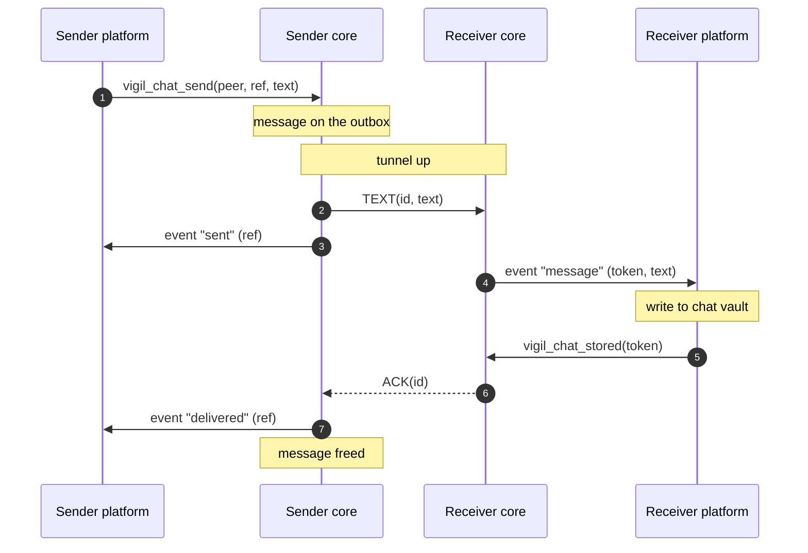
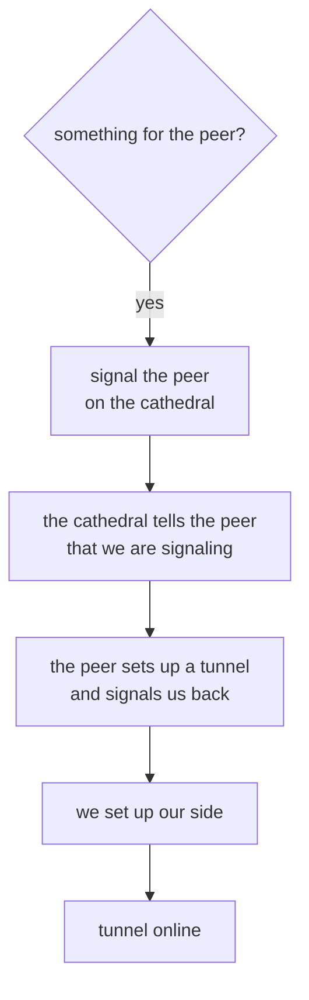
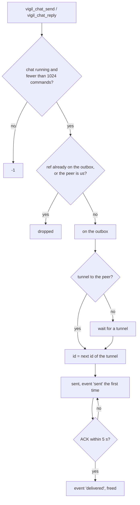
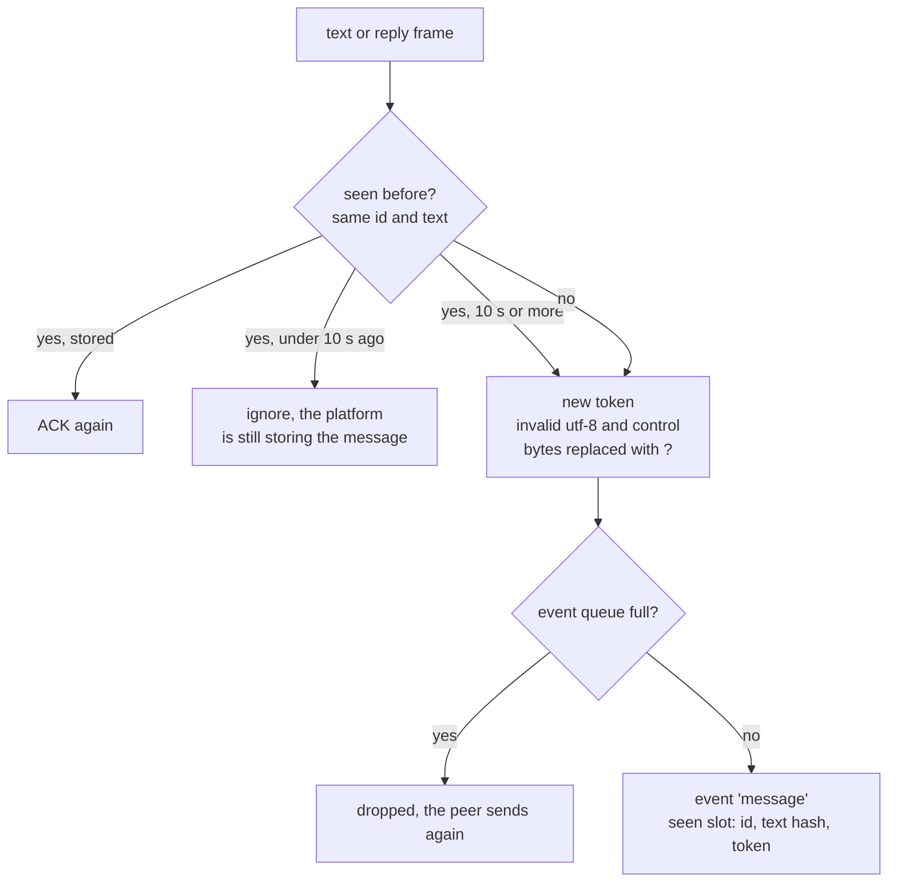

# Chats

Text messages travel as frames over a tunnel of their own between two
phones. One-to-one chats and group chats work the same way, a group chat
has one tunnel with every member. Images, files, voice messages and
avatars use the same tunnels, see [parcel.md](parcel.md).

| Term      | What                                                            |
|-----------|-----------------------------------------------------------------|
| frame     | one message, ack or heartbeat, always 523 bytes on the tunnel   |
| ref       | the number the platform gives a message it sends, ours to keep  |
| id        | the number a message gets on a tunnel, counting up from 1       |
| token     | the number a received message gets, for `vigil_chat_stored()`   |
| outbox    | the messages for a peer that were not acked yet                 |
| seen slot | a message we received, so we can tell a resend from a new one   |
| tally     | how many members acked a group message and how many we wait for |

## Overview



A message stays on the outbox until our peer acks the message or the
platform calls `vigil_chat_forget(peer)`. Messages do not expire, a
message for a peer that is away goes out once there is a tunnel to that
peer again.

## Wire formats

Every multi-byte field is big endian.

```
frame, 523 bytes
+----------+-----+------+----------------------------------------+
| id       | len | type | data[512]                              |
+----------+-----+------+----------------------------------------+
  8          2     1      len bytes used, the rest zero

type  1 text, 2 ack, 3 heartbeat, 4 data ack, 5 reply
id    the message id, the id of the message acked for an ack,
      ffffffffffffffff for a heartbeat
```

A text frame carries up to 512 bytes of text. An ack carries no data. Data
acks are in [parcel.md](parcel.md). A frame with id 0 is dropped.

```
reply data
+--------+------+---------------------------------------+
| author | hash | text                                  |
+--------+------+---------------------------------------+
  1        8      up to 503

author  the peer id of who wrote the message replied to
hash    the hash the platform gave for the message replied to, not 0
```

```
heartbeat data
+-----+----------+--------+----------+--------------+---------------+-------------+
| uid | nick[16] | typing | features | instance[64] | signature[64] | avatar_have |
+-----+----------+--------+----------+--------------+---------------+-------------+
  8     16         1        1          64             64              8

uid          random for each tunnel, a new one means the peer started over
nick         our nickname, empty if we have none
typing       1 while we type in this chat
features     0x01 DATA, 0x02 REPLY, 0x04 NAME, 0x08 AVATAR
instance     our name, signed by our flock, zero without NAME
signature    the signature of our flock over our instance, zero without NAME
avatar_have  the hash of the avatar of this peer that we hold, 0 if none
```

We send `DATA` and `REPLY` always, `NAME` when our flock signed our name
and `AVATAR` while we have an avatar.

## Tunnels



We signal a peer on the chat signaling liturgy, group `0000`, while:

- we hold messages for that peer,
- its chat is open on our side (`vigil_chat_open(peer, 1)`),
- a message of ours was delivered to that peer, or we got one from that
  peer, in the last 60 s,
- that peer signals us and our tunnel with that peer is not online yet.

The cathedral pushes us every peer that signals us. A peer counts as
around until the cathedral has not pushed that peer for 9 s. We keep a
tunnel while the peer is around, or while the tunnel is online and we
still signal the peer. Otherwise the tunnel is closed. The messages on
that tunnel stay on the outbox and get new ids on the next tunnel.

A tunnel is online once its keys are up and while we heard from the peer
in the last 30 s. Frames only go out once the keys are up.

Each tunnel goes through a cathedral of its own, picked at random. A
cathedral that does not answer for 45 s (10 s for a new one) is replaced.
When the configuration allows p2p, a tunnel moves to the direct address of
the peer the same way a call does (see [call.md](call.md)), with these
differences:

```
                              chat                  call
p2p path must work in         30 s                  10 s
heartbeats after moving       every 1 s for 10 s    -
```

## Sending



A message is sent again every 5 s until our peer acks the message, once
the tunnel keys are up. A peer gets the same message more than once and
tells the copies apart by id and text, see below.

### Replies

A reply waits until we heard a heartbeat from the peer, so we know if the
peer takes replies. A peer with `REPLY` gets a reply frame, any other peer
gets the text alone as a text frame.

## Receiving



The platform calls `vigil_chat_stored(token)` once the message is safe in
the chat vault, and only then does our peer get its `ACK`. A message the
platform did not store within 10 s is handed over again under a new token
when it is sent again.

An empty text frame is acked and not handed over.

Each tunnel remembers the last 64 messages it received, text and parcels
together. A new uid in a heartbeat means the peer restarted and its ids
start over, the tunnel then forgets all 64.

## Groups

`vigil_chat_group(id)` joins a group and leaves the one we were in, id 0
leaves. The group is a liturgy of its own on the cathedral. Every member
in it gets a tunnel, and while the group liturgy has timed out we only
keep the tunnels that are online.

```
            group message, ref 7
           /         |         \
   copy, member 02  copy, 05  copy, 09        one tally:
       |               |          |           acked 0, pending 3
   tunnel 02       tunnel 05  tunnel 09
```

A group message is copied once for every member that has a tunnel at that
moment. Members that join later do not get the message, and a message sent
while no member has a tunnel goes nowhere. Each copy is sent again
every 5 s like a one-to-one message. An `ACK` moves a member from pending
to acked, a member whose tunnel closes is no longer pending. The platform
gets an `acks` event with both counts each time they change.

Group messages get no `sent` or `delivered` events.

A message in a group that names us is marked as a mention. That is `@`
followed by our nickname, our signed name or our peer id in hex, in any
case, with no letter, digit, `-` or `_` right before the `@` or right after
the name.

The platform gets `joined` and `left` events for members. The first member
list after joining, or after the group liturgy timed out, gives no events.

## Names

A nickname is 2 to 16 letters and digits, `vigil_chat_nick()` refuses
anything else. A nickname from a peer that does not pass that check is
taken as empty.

A peer with `NAME` sends its name and the signature of its flock over
that name. We show the name only when the signature verifies for that peer
id. The platform gets a `name` event the first time we hear from a peer,
and again when its nickname or signed name changes.

## Platform contract

```
platform calls                              core
──────────────────────────────────────────  ──────────────────────────────────
vigil_chat_send(peer, ref, text, len)       queue a message, -1 if not
vigil_chat_reply(peer, ref, author, hash,   running or 1024 commands wait
    text, len)
vigil_chat_group_send(ref, text, len)
vigil_chat_group_reply(ref, author, hash,
    text, len)
vigil_chat_stored(token)                    ACK the message to the sender
vigil_chat_forget(peer)                     drop the outbox of the peer
vigil_chat_group(id)                        join a group, 0 leaves
vigil_chat_open(peer, on)                   keep signaling the peer
vigil_chat_typing(peer, on)                 typing in a one-to-one chat
vigil_chat_group_typing(on)                 typing in the group
vigil_chat_nick(name)                       our nickname, empty for none
vigil_chat_events(buf, len)                 the events as a JSON array,
                                            buf holds at least 64 KiB
```

The calls for parcels and avatars are in [parcel.md](parcel.md).

An author of 0 in a reply means us.

```
event        fields, besides "peer" and "group" for group events
───────────  ─────────────────────────────────────────────────────────────
message      token, nick, signed, text, mention if it names us,
             author and hash if it is a reply
sent         ref                       first time a message went out
delivered    ref                       the peer stored the message
acks         ref, acked, pending       a group message
joined       nick                      a member joined our group
left         nick                      a member left our group
name         nick, signed              who the peer is
data         see parcel.md
avatar       see parcel.md
ambry        generation                the ambry generation of a tunnel,
                                       once per generation in a group
```

At most 256 events wait for the platform. A message that does not fit is
not acked, so our peer sends the message again.

## Limits

| Define                    | Value  | Scope                                   |
|---------------------------|--------|-----------------------------------------|
| VIGIL_CHAT_MESSAGE_MAX    | 512 B  | text in a frame                         |
| VIGIL_CHAT_REPLY_MAX      | 503 B  | text in a reply                         |
| VIGIL_CHAT_NICK_MAX       | 16     | nickname length                         |
| CHAT_HEARTBEAT            | 12 s   | between heartbeats                      |
| CHAT_RESEND               | 5 s    | before an unacked message goes again    |
| CHAT_STORE_WAIT           | 10 s   | for the platform to store a message     |
| CHAT_IDLE                 | 60 s   | signaling after the last message        |
| CHAT_RX_TIMEOUT           | 30 s   | silence before a tunnel is offline      |
| VIGIL_CALL_PRESENT_EXPIRE | 9 s    | a peer the cathedral stopped pushing    |
| CHAT_P2P_VERIFY           | 30 s   | for a p2p path to show it works         |
| CHAT_HOLEPUNCH            | 10 s   | of 1 s heartbeats after moving to p2p   |
| CHAT_SEEN_MAX             | 64     | seen slots per tunnel                   |
| CHAT_COMMANDS_MAX         | 1024   | commands waiting for the event loop     |
| CHAT_EVENTS_MAX           | 256    | events waiting for the platform         |
