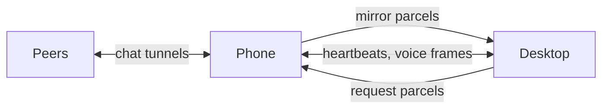
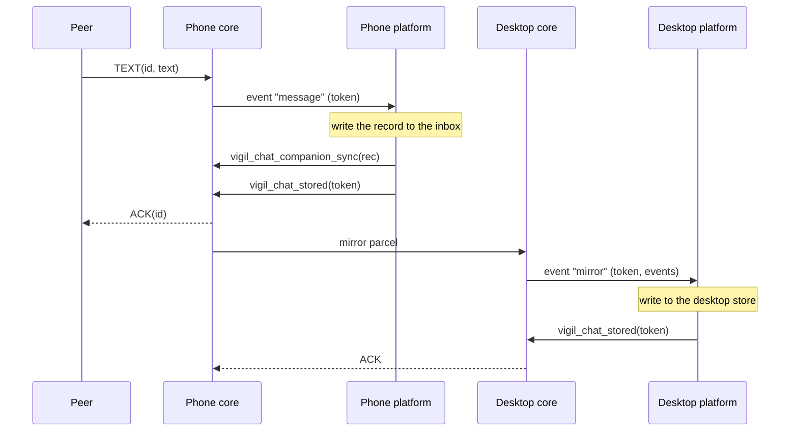
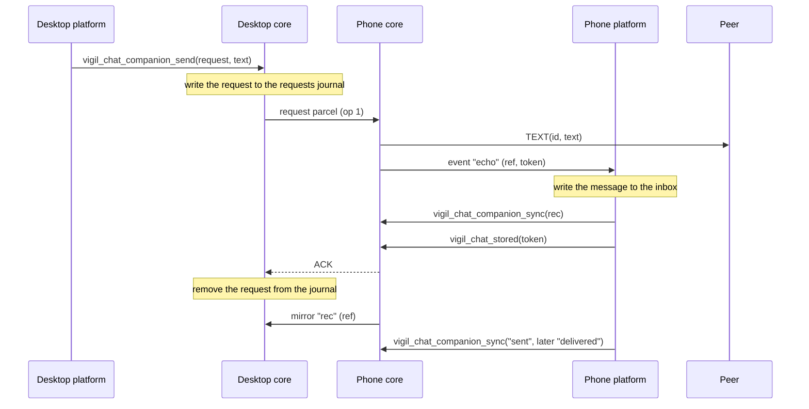

# Companion

A phone can link one desktop, the Linux app. The desktop shows the
phone's chats, sends messages as the phone and can take the phone's
calls. Peers only ever talk to the phone; they never see the desktop.

The desktop has no Gospel configuration of its own. Everything it shows
comes from the phone, and everything it sends goes out through the
phone.

| Term    | Meaning                                                         |
|---------|-----------------------------------------------------------------|
| op      | one change to the phone's chats, as the phone platform made it  |
| journal | numbered ops the phone keeps on disk for the desktop            |
| mirror  | a parcel of journal entries from the phone to the desktop       |
| resync  | a copy of the phone's chats sent to the desktop                 |
| lost    | chats, files and state the desktop missed, kept by the phone    |
| request | a parcel from the desktop to the phone: send, call or ask       |
| ask     | a request the phone platform carries out, such as a new topic   |

## The flock

The phone and the desktop share a flock of their own, set up in Covenant.
KEK `01` is the phone and KEK `02` is the desktop. Each side gets a
configuration with `mode companion`. The spi tells which side it is:

```
spi    0102 on the phone, 0201 on the desktop
```

A companion configuration holds only a cathedral and the keys for it. The
phone keeps it next to its Gospel configuration and does not list it as a
tunnel. The desktop runs it with `vigil_run()`, with no tunnel and no
Gospel.

The desktop can get its configuration from Covenant with secret words.
For that hand over, Covenant adds a temporary device to the flock, and
the temporary device takes the lowest free KEK. So in an empty flock the
desktop must be added first: the temporary device gets `01` and the
desktop `02`. The phone is added afterwards and gets `01`.

## The tunnel

The phone and the desktop keep a chat tunnel up between them as long as
both have their configuration and, on the phone, Gospel runs. The tunnel
starts through the cathedral in the configuration, without a signaling
liturgy, and moves to p2p like any other chat tunnel.

The tunnel carries:

- parcels of kind `5` (`VIGIL_CHAT_DATA_COMPANION`), named `companion`,
  for mirrors and requests,
- acks for those parcels,
- heartbeats, each with the sender's state appended,
- 160-byte voice frames for a call the desktop holds.

Any other frame on this tunnel is dropped.



## Phone to desktop: mirrors

### What the phone mirrors

The desktop keeps a copy of the phone's chat store. Every change the phone
platform makes to its store is sent to the desktop as an op with
`vigil_chat_companion_sync()`, in the order the phone made the changes.
The phone core adds one op of its own: a `self` op with the flock, id and
signed name of each gospel. It sends it the first time it hears from the
desktop, and again when the avatar or the gospels change, with the avatar
as the data.

The desktop shows its copy by the same rules the phone uses for its own
store. It has no rules of its own, and it never sees the phone core's
chat events.

Each op is a JSON object with an `op` field:

```
rec     chat, rec: one record of the chat's log; the data of a message
        is the data of the op
read    chat, topic if any: the chat or topic is read up to this point
delete  chat: the chat is gone
group   chat, info: the group's info, null when the group is gone
name    peer, nick, signed
avatar  peer: the data is the avatar, no data removes it
prefs   stars, compacts, mutes, order, names: the phone's chat settings
        and the names its user gave to peers
answer  id, what, ok, reason if not ok: the answer to an ask. With what
        "send", chat and ref instead: a desktop send to a group the
        phone is no longer in, which the phone did not keep
self    gospels: [{flock, id, signed}], avatar if the data is the
        avatar
reset   a full resync starts, see Resync
avatars peers: the peers that have an avatar, sent in a resync
chat    chat: the resync of this chat starts
batch   ops: several ops of a resync
data    chat, file: the data of one record, sent in a resync
synced  a resync is done
```

The records are the same as in a chat's log on the phone:

```
msg       a message: dir, ref, peer, nick, text, time; qa and qh for a
          reply; tp for a topic; to for the members of a group; data,
          media, name and size for data; ch for an image
member    a group change, kind created, added, joined, left, renamed,
          ended, removed, parted or ambry
topic     tp, name (empty removes the topic), color
sent      ref: our message went out
delivered ref, and member in a group: our message arrived
expired   ref, member: our message never reached that member
fav       ref, on
pin       ref, on
retract   peer, tp, hash, and target for our own: the image with this
          hash from this peer in this topic is gone
```

`ch` is the first 8 bytes of the image's SHA-256 as hex; it is the hash a
retract names. On both the phone and the desktop, a record for a chat
that does not exist is dropped, except `msg`, `member` and `topic`, which
create the chat.

The phone writes each record to its inbox first. The inbox is sealed to
a public key, so the phone can write it while the device is locked;
opening it needs the device unlocked, so the phone moves the inbox into
the chat logs once it is unlocked. The record is mirrored when it is
written to the inbox, so the desktop gets it even while the phone is
locked. The inbox keeps records in order, so the phone's logs and the
desktop's copy hold them in the same order.

### The journal

The phone core writes every event for the desktop to its journal before
sending it, see `src/journal.c`. The journal is the `journal` directory in
the core's data directory. Each entry is a file named after its seq, a
counter that starts at 1 and only goes up:

```
+-------+-----+--------------------------+------+-----+
| nonce | len | JSON event               | data | tag |
+-------+-----+--------------------------+------+-----+
  12      4     len bytes                  rest   16

len     length of the JSON event, big endian
data    the data that belongs to the event, if any
```

The phone adds `at` to each JSON event: the time it wrote the entry, in
milliseconds since the epoch. The desktop shows the event at that time,
not at the time it arrived.

Everything after the nonce is sealed with AES-256-GCM, with the seq as a
big endian u64 for the aad. The key is KMAC256 over the KEK in the
companion configuration, with `VIGIL.COMPANION.JOURNAL` as the label and
the journal's directory name as input. That key does not depend on the
device being unlocked, so the phone can use its journal while locked.

The file `acked` holds the seq up to which the desktop has everything.
The phone deletes entries up to that seq. Entries survive a phone
restart, and the phone continues where the desktop left off.

The journal holds at most 1 GiB, and at most a tenth of the free space on
the phone's disk, which the phone checks every hour. When an op does not
fit, `vigil_chat_companion_sync()` returns -1 and the phone platform adds
the op to what the desktop lost, see Resync. `room` in the `companion`
object of the phone's `chat` status is the space left in the journal.

### The parcel

The phone sends its journal in order, one mirror parcel at a time. It
sends the next parcel once the desktop acked the previous one. After its
tunnel to the desktop comes up, it sends nothing until it has heard a
heartbeat from the desktop. The data of a mirror parcel, after
`struct vigil_chat_data_head`:

```
+-------+------+------+-----------------------------------------+--------+
| count | size | last | entries                                 | data   |
+-------+------+------+-----------------------------------------+--------+
  4       4      8      count times seq (8), len (4), JSON event  size

count   number of entries in the parcel, big endian
size    length of the data, 0 for none, big endian
last    seq of the newest entry in the phone's journal, big endian
seq     seq of the entry, big endian
len     length of the entry's JSON event, big endian
data    the data of the only entry in the parcel
```

The events use the same JSON that `vigil_chat_events()` gives a platform.
Entries without data share a parcel as long as their JSON stays within
32 KiB. An entry with data goes in a parcel on its own.

### On the desktop

The desktop core keeps `have`, the seq up to which its platform stored
the phone's entries, in the file `journal/acked` in its data directory.
It skips entries at or below `have`, and acks a parcel with nothing new
right away.

For each parcel the desktop core gives its platform one `mirror` event
with the entries it did not have yet:

```
mirror  token, size, events
```

`events` is a JSON array of the parcel's ops, and `size` is the length of
the data, which belongs to the last op. The platform stores the ops,
takes the data with `vigil_chat_data_take()` when `size` is not 0, and
calls `vigil_chat_stored()` with the token once ops and data are on disk.
Only then does the desktop core move `have` to the parcel's last entry
and ack the parcel. Without an ack the phone keeps the parcel and sends
it again after 60 seconds, as for any parcel, see [parcel.md](parcel.md).

The desktop's heartbeats carry `have`. The phone deletes its entries up
to `have`, which covers an ack that was lost on the way. If `have` is
past the phone's last seq, the phone moves its counter past it.



### Resync

The desktop core records in `journal/synced` whether its copy is
complete. There are three states:

- not synced: a new desktop, or one that missed entries. The desktop
  missed entries when the first new entry of a parcel is not the one
  right after `have`.
- syncing: the desktop got a `reset` op, so a full copy has started.
- synced: the desktop got the `synced` op that ends a full copy. A
  `synced` op that ends a repair, without a `reset` before it, does not
  change the state.

The desktop sends this state to the phone in every heartbeat.

The `companion` object in the desktop's `chat` status has `sync`, which
is `synced`, `syncing` or `unsynced`, and `behind`: how many of the
phone's journal entries the desktop does not have yet, based on `last`
in the phone's latest parcel. The desktop shows both while it syncs or
catches up.

The phone core gives its platform a `desktop` event with `what` set to
`resync` in two cases: when the desktop is not synced and no resync is
underway, and when the phone could not write an entry to its journal.
The platform then does a full resync.

The phone platform tracks what the desktop lost in `lost.box` in its
chat store: chats, data files, and whether the state (groups, names,
avatars, prefs) was lost. The file is sealed with the outbox key, so it
can be written while the device is locked. When the core refuses an op,
the platform adds the chat of a `rec`, `read` or `delete` op and the data
file of a `rec` op, and marks the state as lost for a `group`, `name`,
`avatar` or `prefs` op. It stops handing the core ops for a lost chat;
the repair of that chat brings them. On iOS the network extension does
this while it moves the app's ops to its core.

On iOS only the app opens chat history, never the network extension. The
app writes a resync, including the `reset` and `synced` marks, to the
queue the extension moves to its core. The extension turns the marks
into `vigil_chat_companion_resync()` calls. So a resync on iOS only
progresses while the app runs.

A full resync goes:

1. `vigil_chat_companion_resync()` with 0, which writes the `reset` op,
2. the head,
3. every chat,
4. a `data` op for every message that still has its data,
5. `vigil_chat_companion_resync()` with 1, which writes the `synced` op.

A repair of what was lost sends the head if the state was lost, then
every lost chat, then a `data` op for every lost data file, then the
`synced` op.

The head is the `prefs` op, a `group` op for every group, a `name` op for
every name, the `avatars` op, and an `avatar` op for every avatar. On iOS
the head starts with the `avatars` op.

A chat is sent as a `chat` op followed by `batch` ops. The batches hold
all of the chat's records, with `read` ops placed where the chat and its
topics were read. Android puts the `chat` op inside the first `batch` op.
For a chat the phone no longer has, the phone sends a `delete` op instead
(on iOS after a `chat` op).

An item stops being lost once the core has taken the ops that carry it:

- a chat: on Android once the core took the chat's last `batch` op, on
  iOS once it took the `chat` op,
- the state: on Android once the core took the whole head, on iOS once
  it took the `avatars` op,
- a data file: once the core took its `data` op.

The phone writes a resync as its journal has room. Ops the phone makes
for a chat while that chat is being resynced wait until the chat is
done. A resync needs the phone to be unlocked.

On `reset` the desktop forgets everything except `self` and `prefs`. On
`chat` it forgets the chat's records but keeps the chat's data. On
`avatars` it drops the avatars of peers not in the list.

## Desktop to phone: requests

### The parcel

The data of a request parcel, after `struct vigil_chat_data_head`:

```
+---------------------------+---------------------------------------+
| struct vigil_chat_request | text, data or the JSON of an ask      |
+---------------------------+---------------------------------------+

op       1 to send, 2 for a call, 3 to ask
ref      the ref of a send or the id of an ask, with
         VIGIL_CHAT_COMPANION_REF set
flock    the flock of the peer, or of the group's owner
peer     who a send goes to (0 in a group), or the peer of a call
kind     the kind of data of a send (0 for text), or the call op
author   author of the quoted message in a reply, 0 for the phone
hash     hash of the quoted message in a reply, 0 for none
topic    the topic, 0 for none
owner    owner of the group, 0 for none
group    id of the group, 0 for none
serial   serial of the group roster the desktop knows
members  in a group, bit n is set when the send goes to peer n
ask      length of an ask's JSON; the ask's data follows the JSON
len      length of name
name     name of the data of a send
```

Multi-byte fields are big endian. The call ops are:

```
1 dial, 2 answer, 3 decline, 4 hang up
```

### The queue on the desktop

The desktop core writes every send and ask to the journal `requests` in
its data directory before it goes out. This journal is sealed the same
way as the phone's journal. The desktop sends requests in order, one
parcel at a time, and removes an entry once the phone has acked it. So
sends and asks wait on disk while the phone is away, and they survive
desktop restarts. The journal holds at most 1 GiB.

Calls are not written to disk. The desktop core holds them in memory, at
most 4096 calls or 32 MiB.

If the desktop core cannot write a send or ask, or a call does not fit,
the request is not sent. The desktop core then gives its platform a
`desktop` event with `"what":"unsent"`; for a send it includes the peer,
or the owner and group, and the ref. The Linux app shows this as an
`answer` op that it does not store.

When it starts, the desktop core gives its platform a `desktop` event
with `"what":"queued"` for every send still in the journal. The event has
the peer, or the owner and group, the ref, the topic, the author and hash
of a reply, and either the text or the kind, name and size of the data.
The Linux app shows these sends as waiting.

### Each request is carried out once

The phone acks a send or ask only after its platform has stored the
result. For a send that is the record of the message; for an ask it is
the `answer` op. Both go into the phone's journal before the ack. So an
ack means the phone did the request, and the result is in the journal.

Because the desktop has only one request in flight at a time, only the
oldest request in its journal can be done without the desktop knowing:
the phone did it, but the ack was lost. The desktop checks for this
before it sends that request again:

- The phone's heartbeat carries `last`, the newest seq in its journal.
- After the tunnel to the phone comes back, or after a desktop restart,
  the desktop sends nothing until it has stored the phone's journal up
  to `last`.
- While it stores entries, the desktop looks for the oldest request's
  ref: as `"ref"` in a record for a send, or as `"id"` in an `answer`
  for an ask. If it finds the ref, it removes the request from its
  journal before it moves `have` past that entry. A crash in between can
  therefore not cause the request to be sent again.

When the desktop sends a request again on the same tunnel within 60
seconds, the phone recognizes the parcel it already took. It acks the
parcel once the result is stored, without doing the request a second
time.

### Send

The desktop platform sends with `vigil_chat_companion_send()`. It takes
a `struct vigil_chat_request` in host byte order, with a ref that has
`VIGIL_CHAT_COMPANION_REF` set, plus the text or data. A send to a group
names all members in one request.

Only messages and data go out as sends. Every other change goes out as
an ask.

The phone queues the send for every peer the request names, as if its
own platform had sent it. It then gives its platform an `echo` event
with a token, and the data if there is any. When the phone cannot queue
the send right now, it does not take the request, and the desktop sends
it again.

The phone platform writes the send to its store as its own message,
under the desktop's ref, and calls `vigil_chat_stored()` with the token.
The store change goes to the desktop as a `rec` op without the data.
Until that op arrives, the desktop shows the send as waiting. The
desktop keeps the data of a send as `<chat>-<ref>.dat`, the same name
the phone gives that record's data. The `sent` and `delivered` records
for the ref follow as ops.



### Call

The desktop platform dials, answers, declines and hangs up with
`vigil_chat_call()`. A call the desktop dials or answers is held by the
desktop. The phone then plays and records no audio itself: it forwards
the peer's voice frames to the desktop and the desktop's frames to the
peer. During such a call the phone's voice status has `"relay":true`.
The desktop encodes, decodes, plays and records the audio.

The desktop rings when its phone rings.

### Ask

The desktop platform asks with `vigil_chat_companion_ask()`: the ask's id
as its ref, JSON of at most 512 bytes, and data if the ask needs it. The
phone core gives its platform the ask in a `desktop` event:

```
desktop  what: "ask", ask: the JSON, token, size of its data if any
desktop  what: "resync", see Resync
```

The JSON of every ask has `id`, a number the desktop picks, which is the
same as the request's ref. The phone platform carries out an ask with
the same code it uses for its own user. The asks are:

```
topic     chat, topic (absent for a new one), name (empty removes), color
retract   chat, ref, hash and topic for a phone that is locked
group     name, members
edit      chat, name, members
leave     chat
delete    chat
read      chat, topic if any
favorite  chat, ref, on
pin       chat, ref, on
star      chat, on
compact   chat, on
mute      chat, until
avatar    the picture is the data, no data removes the avatar
```

Deleting a group the phone is still in first ends the group, or leaves
it when someone else owns it. The phone keeps the `roster` or `leave`
entries for the members in its outbox when it deletes the chat, so they
still go out.

The phone platform answers every ask with an `answer` op and then calls
`vigil_chat_stored()` with the ask's token. The changes an ask makes
reach the desktop as ops; a new avatar arrives as a new `self` op.

## Heartbeats

Each heartbeat on the tunnel carries the sender's state after
`struct vigil_chat_hb`. A side sends a heartbeat right away when its
state changes. A new journal entry on its own does not trigger a
heartbeat.

The phone paces the heartbeats: one every 15 seconds, and every second
while it rings or has a call. The desktop sends no heartbeats on a timer
of its own, it answers each heartbeat from the phone with one of its
own. Only while it punches a hole for a new p2p path does the desktop
send one every second by itself.

```
phone    struct vigil_companion_phone: the flock it is about; which peers
         of that flock are present, online and typing; the group and
         topic of up to 8 of the typing peers; which peers are calling
         the phone; the call the phone has: its flock, peer, state, and
         whether it rings, is outgoing or is held by the desktop; the
         flock, peer, reason and count of the last call that ended;
         last, the newest seq in the phone's journal
desktop  struct vigil_companion_desktop: the flock it is about; which
         peers of that flock the desktop types to; the topic and group
         it types in; have, the seq up to which it stored the phone's
         journal; and whether it is synced
```

A state covers one flock. With several gospels the phone sends the
state of one gospel per heartbeat and takes turns, and sends the gospel
whose state changed right away. The desktop keeps the last state per
flock. The desktop sends the state of the flock it types in; typing in
a group goes before typing to a peer.

Both states start with the magic `0x5643` and the sync version,
`VIGIL_COMPANION_VERSION` at the top of `src/chat.c`, each a big endian
u16. A side without the magic counts as version 0. When the versions
differ, the phone sends no parcels and the desktop takes none, the phone
takes no requests, and neither side applies the rest of the other's
state. Both report `version`, and `other` once they have heard it, in
the `companion` object of their `chat` status, and their apps say which
side needs an update.

The phone applies the desktop's state as if its own platform had set it,
with `vigil_chat_typing()` and `vigil_chat_group_typing()`. The desktop
core puts the phone's state in the `companion` object of its `chat`
status for its platform to show.

## The store of the desktop

The Linux app stores what it gets from the phone the way the phone
stores it. Everything is sealed under a random root key, which is
wrapped under a passphrase, see `app/linux/runner/store.c`:

```
chats/<chat>              the chat's log: its rec, read and batch ops
data/<chat>-<ref>.dat     the data of a record, named as on the phone
state/group-<chat>        the group's last group op
state/name-<peer>         the peer's last name op
state/avatar-<peer>       the peer's avatar
state/prefs, state/self   the last prefs and self op
state/self-avatar         the phone's avatar
```

The app stores each op of a mirror event in its place before it acks the
parcel:

- A `chat` op, or a `batch` op that starts with one, empties the chat's
  log.
- `delete` removes the chat's log, its data and its group.
- `reset` removes all chats, all data and all state except `prefs`,
  `self` and `self-avatar`.
- `avatars` removes the avatars of peers not in its list.
- `synced` and `answer` ops are not stored.
- As on the phone, a `rec` op for a chat without a log is dropped unless
  its record is a `msg`, `member` or `topic`, and so is a `read` op for
  such a chat. Receipts for a deleted chat do not bring its log back.

The app keeps the data of its own sends under the name the phone gives
that record's data, so the phone's record points at the same file.

The desktop core keeps its own state in `core/` in the same directory:
`core/journal` with `acked` and `synced`, and `core/requests`, the
journal of requests that wait for the phone.
