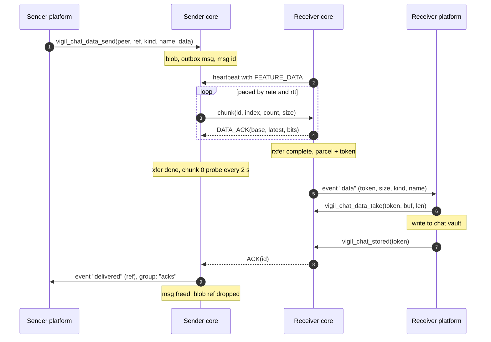
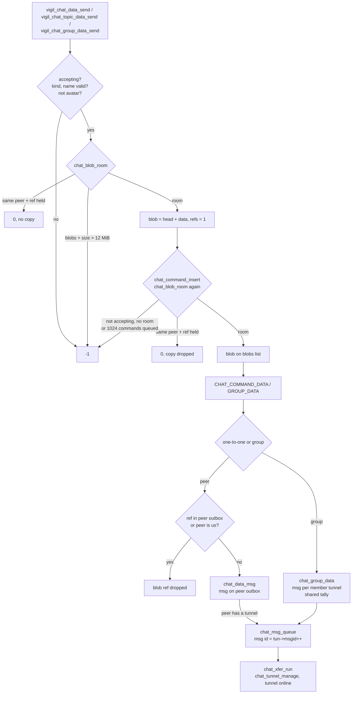
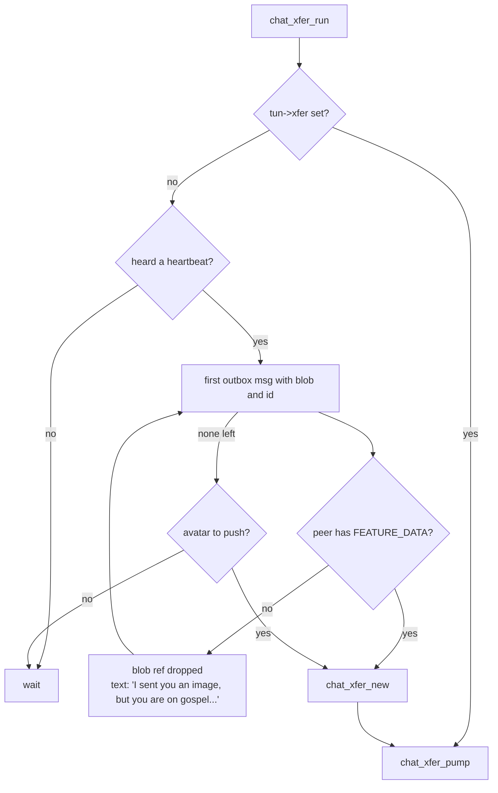
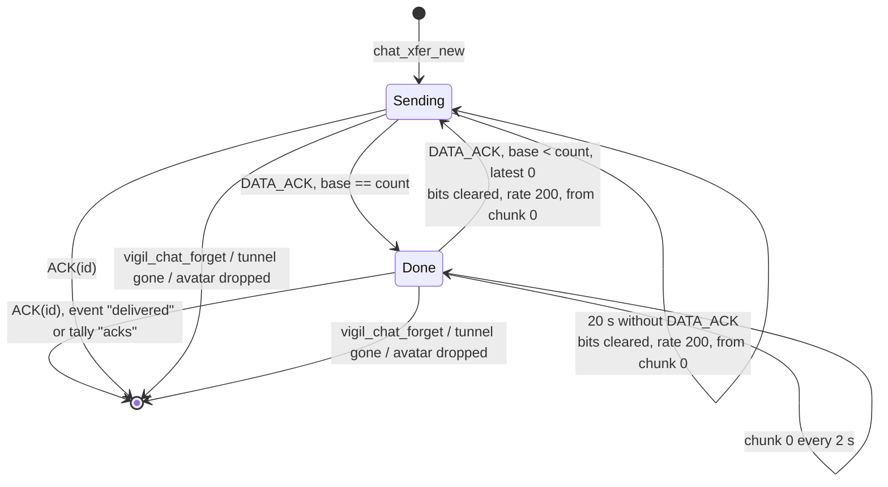
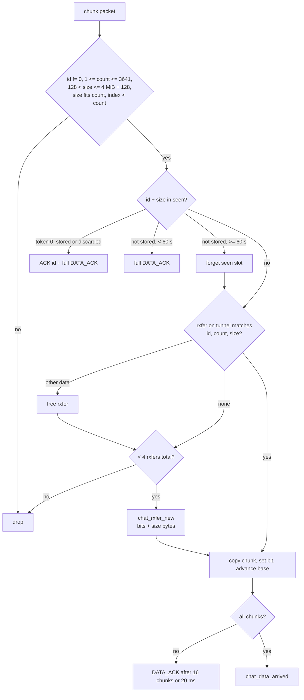
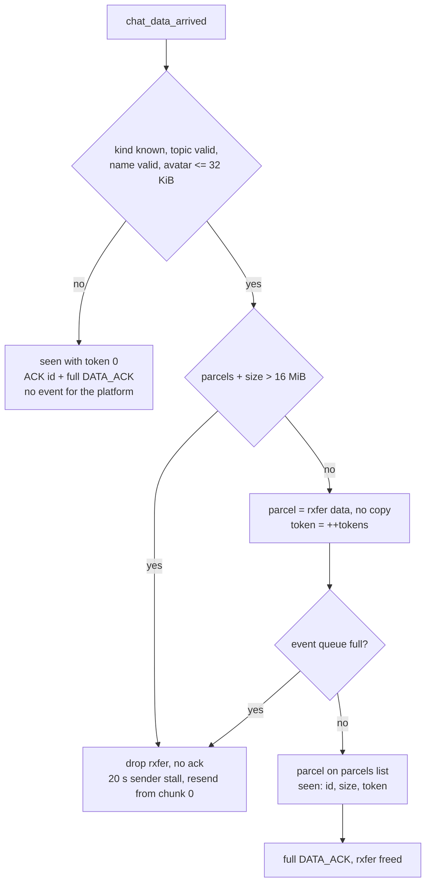
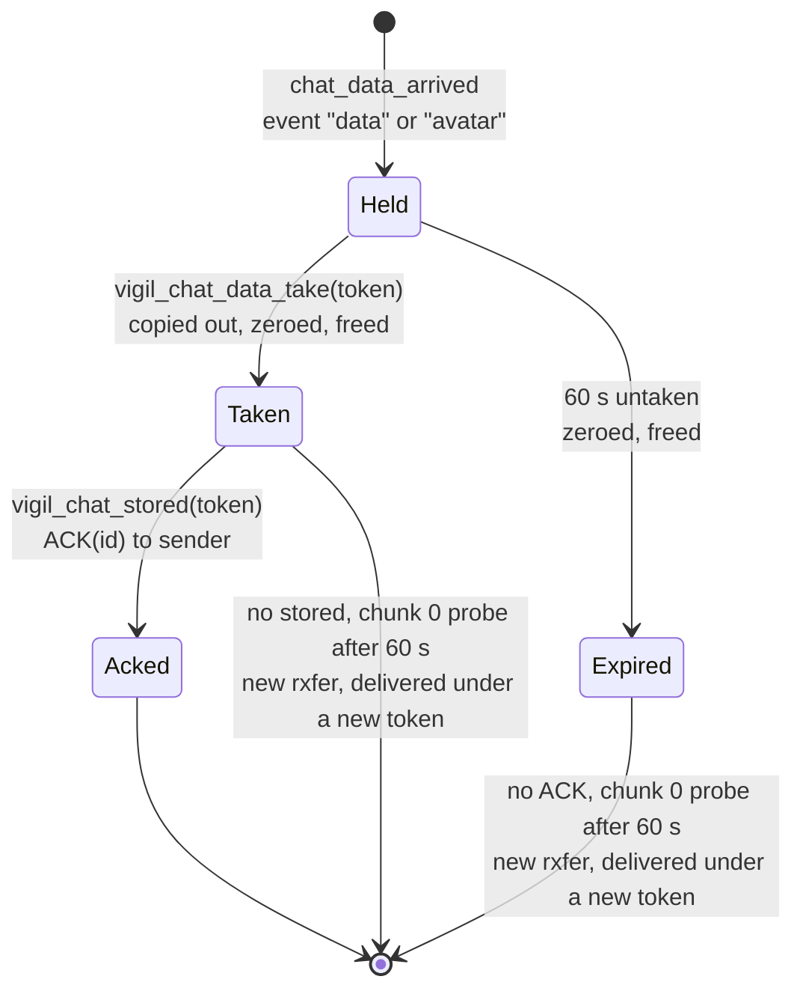

# Parcels

Images, files, voice messages and avatars in a chat travel as parcels.

| Term    | Side     | What                                                      |
|---------|----------|-----------------------------------------------------------|
| blob    | sender   | head + data, held until the last peer ACK                 |
| xfer    | sender   | one outgoing transfer per tunnel, chunk pacing and acks   |
| chunk   | wire     | 1152 bytes of a blob plus its position                    |
| rxfer   | receiver | one incoming transfer per tunnel, reassembly bitmap       |
| parcel  | receiver | complete data until vigil_chat_data_take()                |
| token   | receiver | handle for vigil_chat_data_take() and vigil_chat_stored() |

## Overview



## Wire formats

Every multi-byte field is big endian.

```
blob (sender memory, also the reassembled rxfer)
+------+-----+----------------+---------------------------------+
| kind | len | name[126]      | data (1 .. 4 MiB)               |
+------+-----+----------------+---------------------------------+
  1      1     126              VIGIL_CHAT_DATA_MAX
  \_____ vigil_chat_data_head, 128 _____/

kind: 1 image, 2 file, 3 voice, 4 avatar
```

```
blob in a topic (one-to-one only, kind has 0x80 set)
+------+-----+----------------+----------+----------------------+
| kind | len | name[126]      | topic    | data (1 .. 4 MiB)    |
+------+-----+----------------+----------+----------------------+
  1      1     126              8          VIGIL_CHAT_DATA_MAX
```

A peer without `TOPIC` does not know kind 0x80 and drops data in a topic,
see [chat.md](chat.md). Data in topic 0, in a group, or an avatar in a
topic is dropped too.

```
chunk packet, 1172 bytes (told apart from a frame by its length)
+----------+---------+---------+---------+------------------------+
| id       | index   | count   | size    | data[1152]             |
+----------+---------+---------+---------+------------------------+
  8          4         4         4         VIGIL_CHAT_CHUNK_DATA

id      msg id of the data on this tunnel
index   0 .. count-1, offset is index * 1152
count   ceil(size / 1152), at most 3641
size    blob size including the 128 byte head
```

```
DATA_ACK frame, type 4, 523 bytes
+----------+-----+------+-----------------------------------------+
| id       | len | type | base | latest | bits[504]               |
+----------+-----+------+-----------------------------------------+
  8          2     1      4      4        4032 chunks after base

base    every chunk below base arrived
latest  index of the last chunk received, rtt sample
bits    bit n set = chunk base + 1 + n arrived
```

A complete parcel is acked with `base = count` and `latest = count - 1`.

## Sender



One blob, many messages. Each message holds a reference, the blob is
zeroed and freed with the last one.

```
            blob (refs = 3)
           /      |       \
   msg peer 02  msg peer 05  msg peer 09      group of three
       |            |            |
   tunnel 02    tunnel 05    tunnel 09        one xfer each
```

### Picking what to send



### Pacing

```
credit += elapsed_ms * rate          rate in chunks/s, start 200
credit  = min(credit, 48 * 1000)     burst cap
each chunk costs 1000 credit, max 48 chunks per pump

in flight  <= rate * rtt * 2 / 1000 + 48
resend     unacked chunk after rto = rtt * 1.5 + 30 ms
rtt        rtt = (rtt * 7 + sample) / 8
```

```
rtt sample from DATA_ACK.latest
                 rtt_min           rtt_min*1.25+10      rtt_min*2+20
  ───────────────────┼────────────────────┼────────────────────┼──────▶ rtt
      rate += rate/8 + 8                     unchanged            rate -= rate/8
      (max 8000)                                                  (min 50)
```

### Xfer states



First chunk out: event `sent`, one-to-one chats only. An avatar gets no
`sent`, `delivered` or `acks`, its `ACK` only drops the avatar message.

The avatar xfer is dropped when our avatar changes or a heartbeat from the
peer carries a new `avatar_have` or uid. The avatar is then pushed again
unless `avatar_have` matches ours.

Chunk 0 probe, receiver answer:

| Receiver seen slot                          | Answer                   |
|---------------------------------------------|--------------------------|
| stored or discarded, token 0                | `ACK` + full `DATA_ACK`  |
| not stored, < 60 s since arrival            | full `DATA_ACK`          |
| not stored, >= 60 s since arrival           | slot forgotten, new rxfer, `DATA_ACK` base 1 after 20 ms |
| slot gone                                   | new rxfer, `DATA_ACK` base 1 after 20 ms |

No new rxfer while 4 are running, the probe then gets no answer.

A done xfer that gets a `DATA_ACK` with base below count and latest 0
starts over from chunk 0, the parcel is delivered again under a new token.
A one chunk parcel is complete on chunk 0 alone, it gets a full `DATA_ACK`
right away and needs no restart.

## Receiver



New heartbeat uid from the peer (restart): all seen slots and the rxfer
of that tunnel dropped. 20 s without a chunk: rxfer dropped, checked
only while the tunnel is online.

### Arrival



Name checks: 1 to 126 bytes, invalid utf-8 and control bytes other than
newline and tab replaced with `?`, then no leading `.`, no newline or tab,
no 0x7f, no `/` or `\`. The sender refuses every control byte.

### Parcel lifetime



`vigil_chat_data_take()` returns -1 for an unknown token or a buffer
smaller than the data. It copies out the data only, the 128 byte head
and the topic stay in the core.

## Platform contract

```
event                                 platform
────────────────────────────────────  ──────────────────────────────────────
"data"   peer group token size          vigil_chat_data_take(token, buf, size)
         kind name nick signed          store in chat vault
         topic if in a topic            zero buf
         kind: image | voice | file
                                        vigil_chat_stored(token)

"avatar" peer group token size          same, avatar store
                                        on stored: hash kept as avatar_held

"avatar" token 0, size 0                peer has no FEATURE_AVATAR,
                                        avatar removed, no take, no stored
```

No `stored` means no `ACK`: the sender keeps the blob and the message
stays `sent`, not `delivered`. The next chunk 0 probe 60 s or more after
arrival starts it over and the parcel is delivered again under a new token.

## Limits

| Define               | Value     | Scope                                    |
|----------------------|-----------|------------------------------------------|
| VIGIL_CHAT_DATA_MAX  | 4 MiB     | one parcel, without head                 |
| VIGIL_CHAT_CHUNK_DATA| 1152 B    | one chunk                                |
| VIGIL_CHAT_AVATAR_MAX| 32 KiB    | one avatar                               |
| CHAT_BLOBS_MAX       | 12 MiB    | all blobs held for sending               |
| CHAT_PARCELS_MAX     | 16 MiB    | all parcels waiting for the platform     |
| CHAT_RXFERS_MAX      | 4         | concurrent incoming transfers, all peers |
| CHAT_RATE_START      | 200/s     | first rate of an xfer                    |
| CHAT_RATE_MIN / MAX  | 50 / 8000 | rate bounds, chunks per second           |
| CHAT_CHUNK_BURST     | 48        | chunks per pump                          |
| CHAT_ACK_CHUNKS      | 16        | chunks before a DATA_ACK                 |
| CHAT_ACK_DELAY       | 20 ms     | delay before a DATA_ACK                  |
| CHAT_RTT_START       | 300 ms    | rtt before the first sample              |
| CHAT_DATA_PROBE      | 2 s       | chunk 0 interval once done               |
| CHAT_DATA_STALL      | 20 s      | sender restart, receiver drops rxfer     |
| CHAT_DATA_WAIT       | 60 s      | parcel lifetime before take, seen window |
| CHAT_SEEN_MAX        | 64        | seen slots per tunnel, shared with text  |

Blobs, rxfer buffers and parcels are zeroed before free.

`vigil_chat_busy()` returns true while any rxfer or unfinished xfer
runs, so the event loop speeds up. A done xfer that only probes does
not count.
