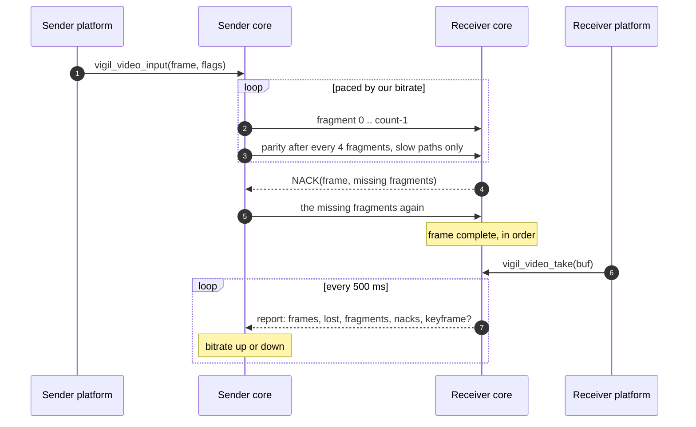
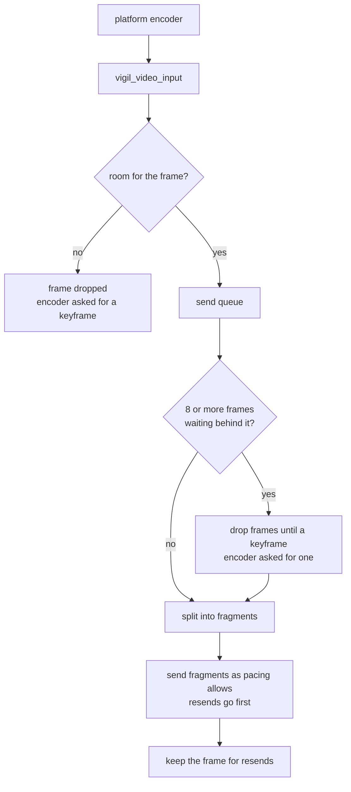
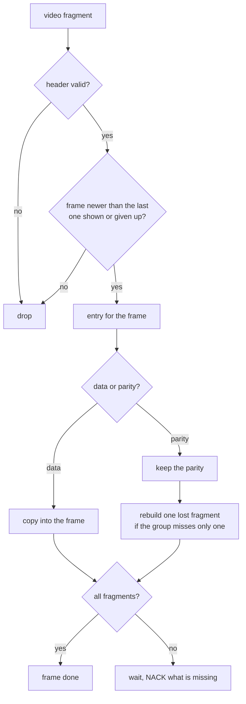
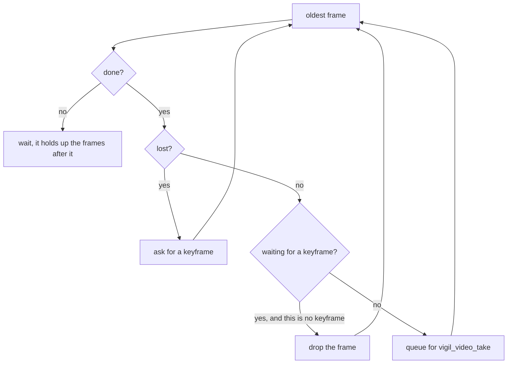
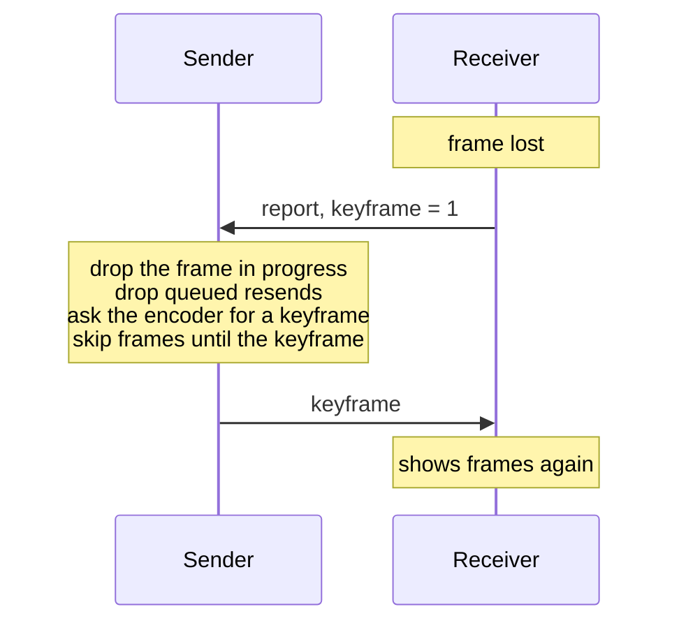

# Video

Video in a call runs over the same tunnel as the voice, inside the voice
session. The platform encodes and decodes the pictures, the core moves
the encoded frames between the two phones.

| Term     | What                                                            |
|----------|-----------------------------------------------------------------|
| frame    | one encoded picture from the platform encoder, at most 1 MiB    |
| keyframe | a frame the decoder can show without any frame before it        |
| fragment | the part of a frame that fits in one packet                     |
| parity   | the xor of a group of fragments, rebuilds one lost fragment     |
| NACK     | the receiver asks for fragments it is missing                   |
| report   | `VIDEO_CTL`, sent every 500 ms: camera, keyframe wanted, counts |
| entry    | a frame the receiver is putting together                        |

Video gets no ACKs. A lost fragment is asked for again, a frame that does
not make it in time is given up on and the receiver asks for a keyframe
to start over from.

Most timers here have a least value and one that grows with the round
trip, written as `400 ms, or 3 * (rtt + 50 ms)`. The longer of the two
counts, so on a fast path the least value is used.

## Overview



Both sides send and receive at the same time, each direction works as
above on its own.

## Wire formats

Every multi-byte field is big endian. Voice frames, reports and NACKs are
all 160 bytes. A video fragment is longer, a packet is a video
fragment when it is longer than 160 bytes and starts with type 3.

```
video fragment, mtu bytes (mtu is at most 1100)
+------+-------+--------+-------+------+----------+----------+-----------+
| type | flags | length | frame | size | fragment | fragsize | data      |
+------+-------+--------+-------+------+----------+----------+-----------+
  1      1       2        4       4      2          2          fragsize
  \______________________ 16 byte header ________________/

type      3
flags     bit 0 keyframe, bits 1-2 quarter turns to rotate the picture by
length    bytes of the frame in this fragment, for parity the group size
frame     frame id, 1 for the first frame and counting up
size      size of the whole frame
fragment  0 .. count-1 for data, count + group for parity
fragsize  mtu - 16, the data of every fragment is padded to this size
```

A frame has `count = ceil(size / fragsize)` fragments, at most 2048.

```
VIDEO_CTL report, 160 bytes
+-------------+--------+----------+-----+--------+------+-----------+-------+
| voice hdr   | camera | keyframe | rtt | frames | lost | fragments | nacks |
+-------------+--------+----------+-----+--------+------+-----------+-------+
  6, type 4     1        1          2     4        4      4           4

camera     1 if our camera is on
keyframe   1 if we want a keyframe
rtt        the round trip we measured in ms, 0 if we have none
frames     frames we handed to our platform since the last report
lost       frames we gave up on since the last report
fragments  fragments we received since the last report
nacks      fragments we asked for the first time or rebuilt from parity,
           since the last report
```

```
VIDEO_NACK, 160 bytes
+-------------+-------+-------+-------------------------------+
| voice hdr   | frame | count | fragments[64]                 |
+-------------+-------+-------+-------------------------------+
  6, type 5     4       2       2 each

count 0 asks for every fragment of the frame
```

## Sender



`vigil_video_input()` returns -1 when the video is not running. It also
returns -1 when the frame is empty or larger than 1 MiB, or when all 128
frames are in use, and the core then asks the encoder for a keyframe,
because the frames after the dropped one cannot be decoded without one.

Fragments are sized for the mtu of the tunnel at the moment the frame
starts going out. A frame that needs more than 2048 fragments is dropped
and the encoder is asked for a keyframe.

A sent frame stays in the history for resends until it was sent more than
500 ms, or 2 * (rtt + 50 ms), ago. The history holds at most 96 frames.

Until the call is answered the core sends no video and drops the frames
the platform gives it. When the call is answered the encoder is asked for
a keyframe, the frames before it were never sent.

### Resends

A NACK for a frame we still hold queues the missing fragments. A NACK with
count 0 queues every fragment we sent of that frame so far. Queued resends
go out before any new fragment. At most 256 fragments wait for a resend,
those past that are dropped and the receiver asks again.

### Parity

On a path with a round trip of 150 ms or more, waiting for a resend takes
too long. The sender then sends one parity fragment after every 4 data
fragments and after the last one. The receiver can rebuild a single lost
fragment of a group from the parity and the other fragments of the group.

```
frame of 10 fragments, groups of 4

  0  1  2  3  P0   4  5  6  7  P1   8  9  P2
```

### Pacing

```
tokens += elapsed_ms * bitrate / 4000      bytes, twice our bitrate
tokens += elapsed_ms * bitrate / 6400      when parity is on, 1.25 times
tokens  = min(tokens, 24000)
each packet costs its length, at most 48 packets per run
```

Pacing at more than our bitrate gets a keyframe out quickly, so the frames
after it are not held up. The cap on the tokens keeps a burst from
queueing the voice up behind it.

The core runs every time the voice session runs, at least every 10 ms.

## Receiver



The receiver puts together at most 96 frames at once. When a frame arrives
and the frames between it and the newest one we know of are missing, those
get an entry too so they can be asked for, if no more than 3 are missing.
When all entries are in use the oldest unfinished frame is given up on.

### Asking for missing fragments

```
first NACK         30 ms after the frame showed up, or rtt / 8
next NACKs         every 100 ms, or rtt + 50 ms
what is asked for  fragments missing below the highest one we got,
                   the ones after it once no new fragment came for 30 ms
                   (or rtt / 8), at most 64 per NACK
nothing yet        count 0, the whole frame
```

### Giving up on a frame

```
no new fragment for     400 ms, or 3 * (rtt + 50 ms)
frame older than        1500 ms, or 4 * (rtt + 50 ms)
```

A frame that is still not complete after 400 ms, or 2 * (rtt + 50 ms),
makes the receiver ask for a keyframe while it keeps waiting. On a bad
path the keyframe may get there before the resends do.

### Handing frames to the platform



Frames go to the platform in order. A missing frame breaks every frame
after it up to the next keyframe, so after any loss the receiver drops
frames until a keyframe arrives and asks the sender for one. A keyframe
that is complete makes the receiver give up on the frames before it that
are still coming in, so they do not hold the keyframe up.

The receiver waits for a keyframe at the start of a call, after a lost
frame, when frame ids skip ahead, when the platform queue is full and when
the platform calls `vigil_video_refresh()` because its decoder started
over.

## Keyframes



While the receiver wants a keyframe it sends a report every 250 ms, or
every round trip plus 50 ms, instead of every 500 ms.

While its camera is off, the sender uses a report only for the camera and
rtt fields. The sender ignores a keyframe request when:

- it already skips frames until a keyframe,
- it honored a request less than 250 ms ago (or rtt + 50 ms),
- it finished sending a keyframe less than 500 ms ago (or rtt + 250 ms),
  requests sent before that keyframe arrived are still coming in,
- the frame it is sending right now is a keyframe.

If the encoder gives no keyframe within 500 ms of skipping, the sender
asks the encoder again.

## Round trip

The sender stamps every frame when its last fragment goes out. The first
NACK for that frame gives a sample: the time since then, minus the 30 ms
(or rtt / 8) the receiver waited before asking.

```
rtt   = sample                      the first sample
rtt   = (rtt * 7 + sample) / 8      every sample after it
used  = the longer of our rtt and the one our peer reports, at most 8000 ms
```

Without loss neither side gets a sample, the rtt stays 0 and every timer
uses its least value.

## Bitrate

Every report from our peer adjusts our bitrate while our camera is on, if
the report counts any frames shown or lost. `ploss` is the share of
fragments our peer had to ask for or rebuild.

```
ploss = nacks * 100 / (fragments + nacks + 1)

lost >= 3 or ploss >= 20             bitrate * 0.70
lost > 0  or ploss >= 10             bitrate * 0.90
a new rtt sample more than 100 ms
(or rtt_min / 4) above the lowest    bitrate * 0.85
ploss < 5, parity on                 bitrate * 1.02
ploss < 5                            bitrate * 1.04
otherwise                            unchanged

bitrate starts at 1 Mbit/s, stays between 150 kbit/s and 2.5 Mbit/s
```

The first rule that matches counts. The platform encoder gets our bitrate,
minus a fifth while parity is on so the parity fits in the bitrate as well.

## Platform contract

```
core calls                            platform
────────────────────────────────────  ──────────────────────────────────────
vigil_platform_video_start()          start the platform video
vigil_platform_video_camera(on)       camera on or off
vigil_platform_video_keyframe()       encode the next frame as a keyframe
vigil_platform_video_bitrate(bps)     encoder bitrate
vigil_platform_video_stop()           stop everything

platform calls                        core
────────────────────────────────────  ──────────────────────────────────────
vigil_video_input(data, len, flags)   a frame to send, -1 if dropped
vigil_video_take(buf, len, &flags)    the next frame to decode, 0 if none,
                                      buf holds at least 1 MiB
vigil_video_camera(on)                the user turned our camera on or off
vigil_video_refresh()                 the decoder started over
```

The core starts the platform video when our camera is on during a call,
or when the call is answered and the camera of our peer is on. Turning our
camera on asks the encoder for a keyframe.

A caller with its camera on sends reports before the call is answered,
so the called side knows about that camera while the call rings.

`vigil_video_status()` adds the video to the voice status:

```
{"camera":bool, "remote":bool, "bitrate":bps, "tx":frames, "rx":frames,
 "lost":frames, "resent":fragments}
```

## Limits

| Define                  | Value          | Scope                                 |
|-------------------------|----------------|---------------------------------------|
| VIGIL_VIDEO_FRAME_MAX   | 1 MiB          | one encoded frame                     |
| VOICE_MTU_MAX           | 1100           | largest mtu of a call                 |
| VIDEO_FRAGMENTS_MAX     | 2048           | fragments in one frame                |
| VIGIL_VIDEO_NACK_MAX    | 64             | fragments in one NACK                 |
| VIDEO_FRAMES            | 128            | frames held in each direction         |
| VIDEO_HISTORY           | 96             | sent frames kept for resends          |
| VIDEO_HISTORY_TIME      | 500 ms         | least time a sent frame is kept       |
| VIDEO_RESENDS           | 256            | fragments waiting for a resend        |
| VIDEO_ASSEMBLY          | 96             | frames put together at once           |
| VIDEO_GAP_MAX           | 3              | missing frames that get an entry      |
| VIDEO_BACKLOG           | 8              | waiting frames before skipping ahead  |
| VIDEO_BURST             | 48             | packets per run                       |
| VIDEO_TOKENS_MAX        | 24000 B        | pacing burst                          |
| VIDEO_RATE_START        | 1 Mbit/s       | first bitrate                         |
| VIDEO_RATE_MIN / MAX    | 150 k / 2.5 M  | bitrate bounds                        |
| VIDEO_FEC_RTT           | 150 ms         | round trip from which parity is sent  |
| VIDEO_FEC_GROUP / MAX   | 4 / 16         | fragments per parity, most accepted   |
| VIDEO_REPORT_INTERVAL   | 500 ms         | time between reports                  |
| VIDEO_KEY_INTERVAL      | 250 ms         | between keyframe requests and honors  |
| VIDEO_KEY_HOLD          | 500 ms         | requests ignored after a keyframe     |
| VIDEO_KEY_RETRY         | 500 ms         | encoder asked again for a keyframe    |
| VIDEO_FRAME_TIMEOUT     | 400 ms         | without a new fragment                |
| VIDEO_FRAME_TIMEOUT_MAX | 1500 ms        | for a whole frame                     |
| VIDEO_NACK_INTERVAL     | 100 ms         | between NACKs for a frame             |
| VIDEO_TAIL_WAIT         | 30 ms          | before asking for the last fragments  |
| VIDEO_RTT_MARGIN        | 50 ms          | added to the rtt in timers            |
| VIDEO_RTT_QUEUE         | 100 ms         | rtt rise that lowers the bitrate      |
| VIDEO_RTT_MAX           | 8000 ms        | highest rtt used                      |
